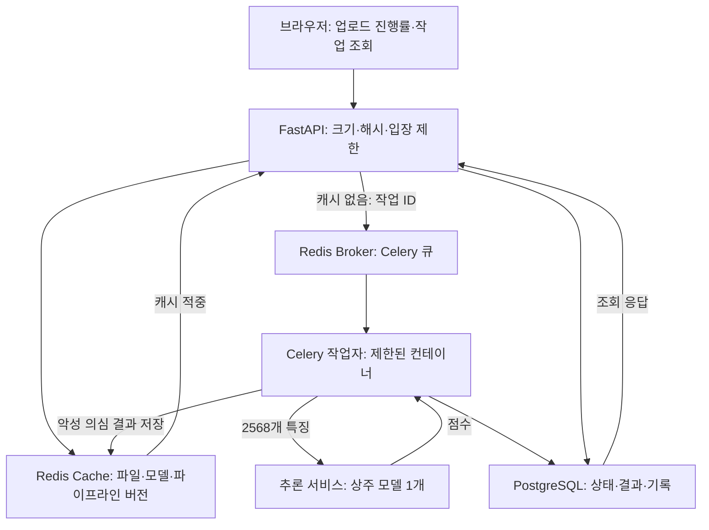
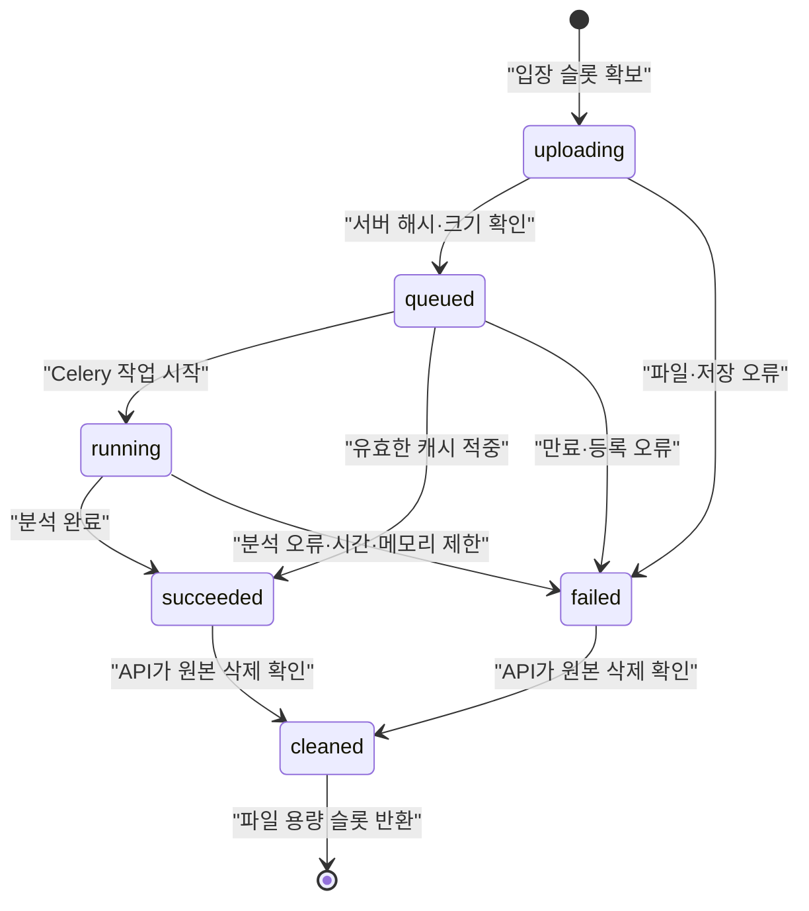
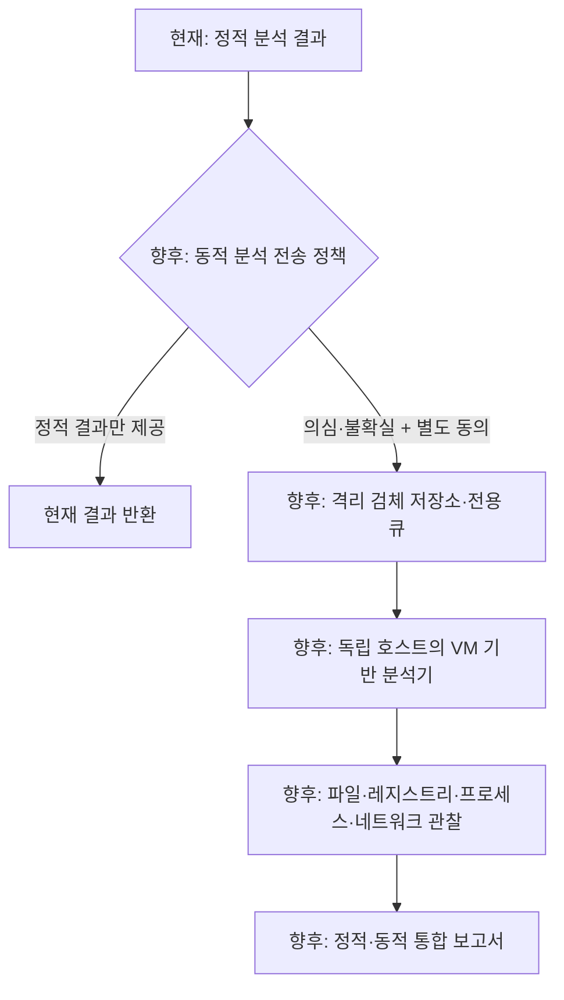

# eNVy 아키텍처

## 현재 구현

기존 요청별 프로세스에 있던 모델 로딩을 **내부 추론 서비스**로 옮겼다. 추론 서비스는 시작할 때 모델을 한 번 로딩한다. 작업자는 파일에서 특징 벡터만 추출해 내부 HTTP API로 전송한다. 서로 다른 프로세스가 하나의 Python 객체를 직접 공유하는 방식은 아니다.

Broker와 Cache는 **서로 다른 Redis 인스턴스**이다. Broker는 작업 메시지를 유지하고 메모리 부족 시 새 쓰기를 거절한다. Cache는 용량에 따라 기존 항목을 제거할 수 있다. 캐시 제거가 작업 메시지 제거로 이어지지 않는다.

### 모델 수명

- 기본 구성: 추론 서비스 프로세스 1개, 모델 인스턴스 1개.
- Celery 작업자를 늘려도 작업자가 Booster를 추가 로딩하지 않는다.
- 추론 서비스를 별도로 복제하면 그 복제본마다 모델 1개가 생긴다. 모든 호스트에서 물리적 모델 메모리 하나를 공유하는 것은 아니다.
- 추론 서비스의 예측 호출은 잠금으로 직렬화한다. 작업자의 특징 추출 병렬화와 모델 추론 처리량은 별도로 측정하고 조정한다.

### 작업 상태와 파일 수명

`cleaned`는 별도 작업 상태 문자열이 아니라 DB의 `input_cleaned`·`slot_reserved` 플래그를 나타낸다. 작업이 끝났다는 이유만으로 파일 용량 슬롯을 먼저 반환하지 않는다. API가 파일 삭제를 확인해야 슬롯을 반환한다. 브라우저가 결과를 조회하면 바로 정리하고, 조회가 없으면 API의 30초 주기 관리 작업이 정리한다.

기본적으로 원본 파일용 작업 공간은 8개까지 예약한다. 종료 후 정리 대기 파일도 여기에 포함한다. 원본 파일은 최대 약 2,400MiB이며, 동시에 허용한 2개 multipart 수신의 임시 파일은 별도이다. DB 결과·로그·이미지·인덱스 공간은 이 계산에 포함되지 않는다.

### 해시 캐시

1. 서버가 업로드 바이트의 SHA-256을 직접 계산한다.
2. 모델 SHA-256, 파이프라인 버전·코드 지문·핵심 패키지 버전, 기준값을 함께 확인한다.
3. 현재 정책은 점수 0.5 이상인 **악성 의심 판정만** 7일 TTL로 캐시한다.
4. 캐시 적중 시 특징 추출·모델 예측을 생략하고, 이번 업로드의 파일명으로 결과를 반환한다.
5. 진행 중인 동일 해시는 Redis의 소유자 확인 잠금으로 중복 작업을 줄인다. 캐시 장애 시 새 분석으로 진행하며, 작업자·큐 한도는 계속 적용된다.

캐시 키가 있다고 파일의 실제 악성 여부가 확정되는 것은 아니다. 또한 SHA 검증을 위해 업로드와 해시 계산은 여전히 필요하다. **Redis 조회 시간과 업로드부터 결과까지의 지연 시간은 다른 지표**이다.

### 분산 실행 범위

기본 배포는 같은 Docker 호스트의 공유 볼륨을 사용하는 다중 컨테이너 구성이다. `--scale worker=2`로 같은 호스트에서 작업자를 늘릴 수 있다. 여러 물리 호스트로 확장하려면 공유 볼륨을 객체 저장소 또는 검체 저장 서비스로 대체하고, 작업자가 해시를 검증한 검체를 받아오는 절차가 추가로 필요하다.

## 향후 확장: 동적 분석 — 미구현

아래는 **계획된 구조**이다. 현재 코드는 검체를 동적 분석기로 보내거나 실행하지 않는다.

추가로 설계·검증할 항목:

- 정적 점수·파싱 경고·불확실성을 활용한 전송 정책을 검증 데이터에서 결정한다. 엔트로피 하나로 전송 대상을 확정하지 않는다.
- 현재 원본은 분석 후 삭제하므로, 동적 분석을 선택한 경우에만 TTL·암호화·접근 통제가 있는 별도 보관 정책을 적용한다.
- 동적 분석은 웹/API 호스트나 정적 분석 컨테이너에서 수행하지 않는다. 독립 VM 호스트, 스냅샷 복원, 제한된 가상 네트워크를 사용한다.
- 실행 승인·전송·보관·삭제 이력을 기록하고 외부 통신 허용 범위와 검체 반출 정책을 별도로 정한다.
- Cuckoo/CAPE 등 후보 도구의 현재 유지보수·운영 조건을 조사한 뒤 선정한다. 이 저장소는 해당 도구를 설치하거나 연결하지 않는다.

정적 분석이 패킹·실행 시 복호화된 동작을 모두 설명할 수 없다는 문제를 보완하기 위한 확장 계획이며, 동적 분석 역시 탐지 보장을 의미하지 않는다.
