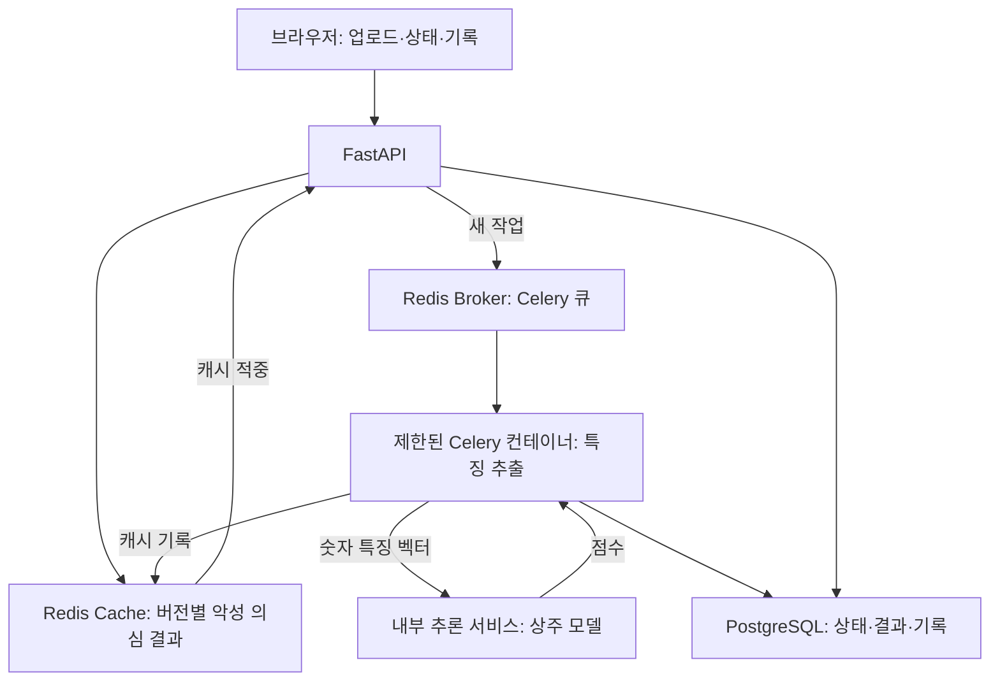

<p align="center"></p>

# eNVy

**Windows PE 파일을 실행하지 않고 분석하는 웹서비스입니다.**

`.exe`·`.dll` 파일의 악성 의심 점수와 PE 상세정보를 제공합니다. FastAPI가 업로드와 작업 조회를 담당하고, Celery가 특징 추출을 수행하며, 별도 추론 서비스가 메모리에 상주한 EMBER2024 LightGBM 모델을 재사용합니다.

> 모델의 추정 결과입니다. ‘정상으로 추정’이라는 결과도 파일의 안전을 보장하지 않습니다.

## 구현 현황

| 항목 | 현재 구현 |
|---|---|
| 검사 화면 | 파일 선택·드래그, 실제 업로드 진행률, 대기·분석 단계 조회 |
| 파일 범위 | Windows PE `.exe`·`.dll`, 최대 300 MiB |
| 정적 분석 | EMBER2024 특징 2,568개, 사전학습 LightGBM 모델 |
| 상세정보 | SHA-256, PE 헤더, 섹션 크기·엔트로피·권한, 일반 임포트 |
| 모델 재사용 | 추론 서비스 시작 시 1회 로딩, 작업자들은 내부 RPC 사용 |
| 비동기 작업 | Celery prefork + Redis Broker, 작업 ID 기반 조회 |
| 캐시 | 검증한 SHA-256·모델·파이프라인 버전에 맞는 악성 의심 결과 재사용 |
| 검사 기록 | PostgreSQL의 작업 상태·판정·점수·기록, 최근 20건 UI |
| 입장 제한 | 동시 업로드 2개, 정리 대기까지 포함한 검체 공간 8개 |
| 자원 격리 | Docker Compose의 비루트·읽기 전용·권한·메모리·CPU·PID·네트워크 설정 |
| XAI·동적 분석 | **미구현**. 별도 설계 문서와 향후 파이프라인 제공 |

## 아키텍처



모델은 작업마다 다시 로딩하지 않습니다. 기본 추론 서비스 프로세스가 모델 객체 하나를 유지하고, Celery 작업자들은 특징 벡터를 HTTP RPC로 보냅니다. 서로 다른 Python 프로세스의 객체를 직접 공유하는 방식은 아닙니다. 추론 서비스를 복제하면 복제본마다 모델 하나가 생깁니다.

자세한 작업 수명과 확장 구조는 [아키텍처 문서](docs/ARCHITECTURE.md), 컨테이너 경계와 잔여 위험은 [보안 문서](docs/SECURITY.md)를 참고합니다.

## 설치 및 실행 — Windows + Docker

이 확장 버전의 기본 실행 환경은 Docker의 Linux 컨테이너입니다. Celery prefork와 자원 제한을 포함한 서비스 전체를 Compose로 실행합니다.

### 1. 새 폴더에서 준비

기존 작동 버전을 보관하고, 이 소스를 새 폴더에 풉니다. [Docker Desktop](https://docs.docker.com/desktop/setup/install/windows-install/)에서 Linux 컨테이너를 사용할 수 있어야 합니다.

프로젝트 최상위 폴더의 PowerShell에서 확인합니다.

```powershell
docker version
docker compose version
```

### 2. 기존 모델 복사

`models` 폴더를 만들고 기존 프로젝트의 `EMBER2024_PE.model`을 복사합니다.

```powershell
New-Item -ItemType Directory -Force models
```

최종 경로는 **`models/EMBER2024_PE.model`**입니다. 모델은 ZIP·Git·컨테이너 이미지에 포함하지 않습니다.

기존 모델이 없다면 [공식 모델 페이지](https://huggingface.co/joyce8/EMBER2024-benchmark-models/blob/main/EMBER2024_PE.model)에서 다운로드합니다. 사용한 모델의 SHA-256:

```text
4252027863492ac138785c8c18576f43dad77d00faddc14e8c0072e8db419f99
```

```powershell
Get-FileHash .\models\EMBER2024_PE.model -Algorithm SHA256
```

### 3. 내부 서비스 비밀번호 생성

```powershell
.\scripts\setup.ps1
```

스크립트는 DB·Redis용 난수 비밀번호를 `.env`에 생성하며, 기존 `.env`를 덮어쓰지 않습니다. `.env`는 Git에 올리지 않습니다. DB 볼륨을 유지하면서 비밀번호 파일을 임의로 재생성하면 기존 DB 인증과 맞지 않을 수 있습니다.

### 4. 구성 확인과 실행

```powershell
docker compose config --quiet
docker compose up --build -d
docker compose ps
```

브라우저에서 **[http://127.0.0.1:8000](http://127.0.0.1:8000)**에 접속합니다. 첫 빌드에는 이미지·패키지 다운로드가 필요합니다.

```powershell
# 실행 로그 확인
docker compose logs -f api worker inference

# 중지: DB·큐·업로드 볼륨은 유지
docker compose down
```

이 프로젝트의 개발 환경에서는 Docker 실행 파일이 없어 이미지 빌드와 서비스 전체 실행을 검증하지 못했습니다. 아래 검증 범위를 확인하고, 첫 실행에서 서비스 health와 실제 파일 분석을 점검합니다.

## 사용 방법

1. 파일을 선택하고 **파일 검사하기**를 누릅니다.
2. 실제 전송량 기준 업로드 진행률을 확인합니다.
3. 업로드가 끝나면 작업 접수·대기열·상세정보 추출·특징 추출·추론 등의 상태를 표시합니다.
4. 완료 후 판정·모델 점수·PE 상세정보를 확인합니다.
5. 같은 파일의 유효한 악성 의심 캐시가 있으면 기존 분석 결과를 사용했다는 표시가 나옵니다.
6. 최근 검사 기록에서 완료된 파일명을 누르면 결과를 다시 볼 수 있습니다.

**업로드 100%는 모델 분석 완료를 뜻하지 않습니다.** 서버 응답 대기 시간은 파일 준비·큐 대기·분석 등을 포함하며, 분석 완료율의 백분율은 아닙니다.

기본 구성은 로컬 데모용이며 사용자 인증은 없습니다. 기록은 같은 인스턴스의 사용자들이 공유합니다. 외부 공개 전 인증과 사용자별 기록 접근 통제가 필요합니다.

## 큐·캐시·기록 정책

### 큐와 파일 공간

- 기본 Celery 작업자 컨테이너는 prefork 자식 1개로 분석합니다. 작업자 복제본을 늘려 병렬 특징 추출을 확장할 수 있습니다.
- 동시에 업로드를 처리하는 HTTP 요청은 API 프로세스당 2개로 제한합니다. 요청 본문 크기도 읽는 동안 제한합니다.
- 대기·분석·완료 후 정리를 포함해 원본 파일 작업 공간을 최대 8개까지 예약합니다. 한도를 넘으면 `429`를 반환합니다.
- 작업 종료와 원본 삭제를 구분합니다. **원본 삭제 확인 후**에만 파일 공간 슬롯을 반환합니다.
- 브라우저가 완료 결과를 조회하면 원본을 정리하고, 조회가 없으면 API가 30초 주기로 정리합니다. 정리 실패 시 슬롯을 유지해 추가 파일로 디스크가 계속 늘어나는 것을 막습니다.

검체 공간의 원본 최대치는 약 2,400 MiB입니다. 동시에 받는 multipart 임시 파일 2개는 최대 약 600 MiB가 별도로 필요합니다. DB·이미지·로그와 추가 여유 공간은 별도입니다. 정상적인 동시 업로드 과정에서는 한 파일의 업로드 임시본과 분석용 복사본이 잠시 함께 존재할 수 있습니다.

### 캐시

- 서버가 파일을 읽으며 SHA-256을 직접 계산합니다. 클라이언트가 주장한 해시만으로 캐시 판정을 하지 않습니다.
- 키에는 파일 SHA-256, 모델 SHA-256, 파이프라인 버전·코드 및 핵심 패키지 지문, 기준값이 반영됩니다.
- 현재 정책은 **점수 0.5 이상인 악성 의심 판정만 7일 TTL로 캐시**합니다. 정상 추정 결과는 기록에는 남지만 이 캐시 정책으로 재사용하지 않습니다.
- 캐시에는 이전 사용자의 파일명·작업 ID·응답 지연 시간을 저장하지 않습니다.
- 진행 중인 같은 파일의 중복 작업은 Redis 소유자 잠금으로 줄입니다. Redis 캐시 장애 시 유효하지 않은 결과를 반환하지 않고 새 분석으로 진행합니다.
- Broker와 Cache Redis를 분리해 캐시 항목 제거가 대기 작업 삭제로 이어지지 않게 합니다.

캐시 적중도 업로드·해시 계산·DB 기록 시간이 필요합니다. **업로드부터 결과까지 `0.1초`라고 보장하지 않습니다.** 캐시 조회 시간만 별도로 측정하려면 이미 캐시된 해시에 대해 다음 명령을 사용합니다.

```powershell
docker compose exec api python -m scripts.benchmark_cache <캐시된_SHA256>
```

출력은 캐시 조회의 중앙값·p95이며 업로드와 전체 응답 지연은 제외합니다.

### DB 기록

PostgreSQL에 작업 ID, 파일명·해시·크기, 모델 버전, 상태·단계, 점수·판정·상세 결과, 캐시 여부와 시간을 저장합니다. 원본 검체는 DB에 넣지 않습니다. 원본 삭제가 확인된 완료 기록은 기본 30일 보관 후 정리합니다.

## 기본 설정

| 설정 | 기본값 |
|---|---:|
| 최대 파일 크기 | 300 MiB |
| 파일 복사 단위 | 1 MiB |
| 동시 업로드 | API 프로세스당 2개 |
| 예약 가능한 검체 작업 공간 | 8개 |
| Celery 자식 동시 실행 | 작업자 컨테이너당 1개 |
| 분석 soft / hard 제한 | 300초 / 330초 |
| 큐 대기 만료 | 1,800초 |
| 악성 의심 캐시 TTL | 7일 |
| DB 기록 보관 | 30일 |

`envy/config.py`와 `compose.yaml`에서 관리합니다. 화면은 `/config`의 실제 용량 설정을 사용합니다. 동일 호스트에서 작업자를 늘리는 예:

```powershell
docker compose up -d --scale worker=2
```

추가 작업자마다 설정한 컨테이너 자원이 필요합니다. 추론 서비스는 그대로 하나를 공유합니다. 현재 파일 공유는 같은 Docker 호스트의 볼륨을 전제로 하며, 다중 물리 호스트 확장에는 검체 저장소 설계가 추가로 필요합니다.

## 컨테이너 보안 경계

- API·작업자·추론 서비스는 비루트 UID, 읽기 전용 루트 파일시스템, capability 제거, `no-new-privileges` 설정을 사용합니다.
- 작업자는 원본 볼륨을 **읽기 전용**으로 마운트하며 모델 파일·Docker 소켓·호스트 폴더를 마운트하지 않습니다.
- 추론 서비스만 모델 폴더를 읽기 전용으로 마운트합니다. 검체는 받지 않고 길이·타입·범위를 확인한 숫자 특징 벡터만 받습니다.
- 작업자 컨테이너에는 메모리 3 GiB, CPU 2개 상당, PID 128개 제한을 설정했습니다. Celery의 메모리 기준 재활용은 작업 후 동작하며, 실행 중 강제 메모리 경계는 Docker 설정이 담당합니다.
- 내부 서비스는 내부 전용 네트워크를 사용하고, 웹 포트만 `127.0.0.1:8000`으로 공개합니다.

컨테이너는 공유 커널을 사용하며 VM급 격리나 취약점 부재를 보장하지 않습니다. 작업자는 내부 DB·Redis·추론 서비스와 통신할 권한이 있으므로 파서 침해 시 이 경계도 고려해야 합니다. 적용 설정과 검증해야 할 항목은 [SECURITY.md](docs/SECURITY.md)에 기록했습니다.

## API

| 메서드 | 경로 | 용도 |
|---|---|---|
| GET | `/` | 검사 화면 |
| POST | `/scan` | multipart `file` 하나 제출: 새 작업 `202`, 캐시 적중 `200` |
| GET | `/jobs/{job_id}` | 상태·단계·결과 조회 |
| GET | `/history` | 최근 20개 요약 기록 |
| GET | `/config` | 화면용 설정 |
| GET | `/health` | API 준비 상태·예약 공간 수·모델 버전 |

`POST /scan`은 작업 정보의 `job_id`·`status`를 반환합니다. 결과는 `succeeded` 상태의 `result` 안에 있습니다. 클라이언트는 완료·실패까지 작업 ID를 조회합니다. 이전 단일 요청 버전의 최상위 `score` 응답과는 계약이 달라졌으므로 이 버전의 화면을 함께 사용합니다.

실패한 작업은 조회 HTTP 응답이 `200`이어도 작업의 `status: failed`와 `error`를 확인해야 합니다. 업로드의 잘못된 형식·크기는 `400/413`, 입장 제한은 `429`, 등록 장애는 `503`으로 안내합니다.

## 판정과 상세정보의 의미

점수 0.5 미만은 ‘정상으로 추정’, 0.5 이상은 ‘악성으로 의심’으로 표시합니다. 점수는 검증 없이 실제 악성 확률로 해석할 수 없습니다.

상세정보의 엔트로피·임포트 목록은 파일 구조 정보입니다. 높은 엔트로피만으로 악성을 확정하거나, 임포트 함수가 실제 실행됐다고 판단하지 않습니다. PE32/PE32+는 헤더 형식이며 .NET AnyCPU의 실제 실행 비트수와 다를 수 있습니다. 일반 임포트만 표시하고 섹션·DLL·DLL당 함수 목록은 각각 최대 128개까지 표시합니다.

## 검증

개발용 의존성을 설치한 환경에서:

```powershell
python -m pip install -r requirements-dev.txt
python -m unittest discover -s tests -v
```

| 검증 항목 | 상태 |
|---|---|
| DB 입장 제한·작업 상태·삭제 확인 후 슬롯 반환 | SQLite 기반 동시성 테스트 통과 |
| 해시·모델 버전별 캐시·TTL·소유자 잠금 | fakeredis 기반 테스트 통과 |
| API 업로드·큐 접수·캐시 적중·기록·오류 정리 | 실제 FastAPI 테스트 통과 |
| Celery 등록 작업·재시도·soft/hard 실패 처리 | 컴포넌트·eager 테스트 통과 |
| 실제 공개 모델의 기존 예측과 RPC 예측 | 동일한 0 벡터에서 점수 일치, 3회 요청 모델 로딩 1회 확인 |
| Docker 서비스·마운트·권한·자원·의존성 구성 | 정적 검토 수행 |
| 실제 Docker + Redis + PostgreSQL + prefork 통합 실행 | **이 개발 환경에서 미실행** |
| 실제 100MB PE의 신규 구조 전체 분석·100명 부하 | **미측정** |

캐시·작업 테스트는 실제 악성코드를 다운로드하거나 실행하지 않습니다. 의도적인 오류 복구 테스트에서 ERROR 로그가 나올 수 있으며, 마지막 테스트 결과를 확인합니다.

### 기준 모델의 기존 평가 결과

초기 정적 모델 검증에서 EMBER2024 PE 테스트 특징 데이터의 SHA-256 중복을 제거하고 집계한 결과입니다. 이번 Docker 확장 버전의 전체 처리량·응답 속도·보안성을 측정한 수치는 아닙니다.

| 항목 | 결과 |
|---|---:|
| 고유 파일 | 539,940 |
| 정상 / 악성 | 269,940 / 270,000 |
| Accuracy | 98.0322% |
| Precision | 98.4724% |
| Recall | 97.5785% |
| False Positive Rate | 1.5140% |
| F1 / ROC-AUC | 0.980234 / 0.998188 |

| 실제 정답 | 정상 예측 | 악성 예측 |
|---|---:|---:|
| 정상 | 265,853 | 4,087 |
| 악성 | 6,538 | 263,462 |

현재도 공개 사전학습 모델을 사용하며 자체 학습 모델은 아닙니다. 특징 벡터는 기존과 같은 float32 표현을 사용하지만, 확장 버전의 실제 PE 전체 경로와 부하 성능은 별도로 재검증해야 합니다.

## 향후 과제: SHAP·동적 분석

- **SHAP:** 특징 차원·이름 매핑, 해시 임포트 특징의 충돌 처리, 같은 모델·벡터에서 기여도 합산 검증 후 시각화할 계획입니다. 현재 상세정보 목록을 모델 설명으로 대신하지 않습니다.
- **동적 분석:** 정적 결과 중 정책에 해당하는 파일을 별도 검체 저장소·큐를 거쳐 독립 VM 기반 분석기로 보내는 구조를 계획했습니다. 현재 코드는 전송하거나 실행하지 않습니다.

미구현 기능의 완료 기준은 [FUTURE_WORK.md](docs/FUTURE_WORK.md), 동적 분석 확장 다이어그램은 [ARCHITECTURE.md](docs/ARCHITECTURE.md)를 참고합니다.

## 파일 구성

| 경로 | 역할 |
|---|---|
| `envy/api.py` | 업로드·작업 조회·검사 기록·원본 정리 |
| `envy/store.py` | PostgreSQL 작업·기록·예약 공간 관리 |
| `envy/cache.py` | Redis 결과 캐시·중복 잠금 |
| `envy/tasks.py` | Celery 작업·실패·시간 초과 처리 |
| `envy/engine.py` | 검체 확인·PE 분석·특징 추출·RPC |
| `envy/inference.py` | 모델 1회 로딩·내부 예측 API |
| `envy/pe_details.py` | 해시·섹션·임포트 상세정보 |
| `envy/config.py` | 설정·분석 파이프라인 지문 |
| `static/` | 업로드 진행률·작업 상태·결과·기록 화면 |
| `compose.yaml` / `Dockerfile` | 서비스 구성·이미지·자원 경계 |
| `scripts/setup.ps1` | 내부 DB·Redis 비밀번호 생성 |
| `scripts/smoke.py` | 파일 제출 후 작업 상태 확인 |
| `scripts/benchmark_cache.py` | 기존 캐시 조회 지연 측정 |
| `tests/` | API·DB·캐시·추론·작업 컴포넌트 테스트 |
| `docs/` | 현재 아키텍처·보안·향후 과제 |

## 출처

- [EMBER2024 공식 저장소](https://github.com/FutureComputing4AI/EMBER2024)
- [고정한 특징 추출 코드 커밋](https://github.com/FutureComputing4AI/EMBER2024/tree/0ef753e81d98bf209f71b03cd331dfc190b5b54d)
- [공식 사전학습 모델](https://huggingface.co/joyce8/EMBER2024-benchmark-models)
- [EMBER2024 논문](https://arxiv.org/abs/2506.05074)
- [Celery 작업자 문서](https://docs.celeryq.dev/en/stable/userguide/workers.html)
- [Docker Compose 서비스 설정](https://docs.docker.com/reference/compose-file/services/)

모델·데이터·라이브러리는 각 원출처의 라이선스와 이용 조건을 따릅니다. 검체·모델·비밀번호·대용량 평가 데이터는 Git에 올리지 않습니다.
